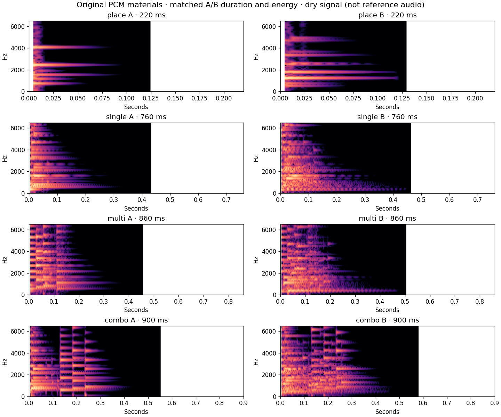

# Block Blast 音效实验室 V2

试听：[V2 · A/B 对比](https://zslhentai.github.io/block-blast-web/audio-lab/v2.html)；[保留的第一版](https://zslhentai.github.io/block-blast-web/audio-lab/index.html)。

本轮解决第一版“像简单电子提示音、材质与奖励层次不足”的反馈。仅新增实验室候选；正式游戏音效、规则、计分、存档、触控、布局、渲染和动画保持不变。第一版合成器和播放器源码也保持不变，只在第一版页面添加通往 V2 的链接。

## 参考依据与边界

重新阅读了 [原版录屏研究](https://zslhentai.github.io/block-blast-web/audio-lab/report.md)，继续采用其中经过实际 PCM 解码、频谱及画面对齐支持的观察：

- 4.95、6.19 秒附近为普通放置后的明亮短音，约 140–150 ms；5.20 秒附近的低中频声音属于拿起下一块，不能混作放置参考。
- 18.70 秒附近的单行消除具有快速起音和约 1 秒的衰减层次，主要音组接近 C 大三和弦。
- 25.22 秒单行 + Combo 2 与 7.81 秒双行 + Combo 2 的主音组相似；27.12 秒双行 + Combo 3 再上移约半音。升调与连击有关是一项合理推断，不是原版规则源码证据。
- 多行、Combo、Perfect 与后续拿起/计分声音存在叠加，不能从该片准确分离每一层；原版采用了什么采样器或混响也未知。

V2 没有重新声称人工听辨原声或精确还原。本轮的“敲击、拨弦、颗粒、房间反射”是原创声音设计选择，**不是已从原版分离出的音源结论**。没有截取、改速或再发布原版录音；没有第三方音频、乐器采样或外部混响素材。音色是否达到目标，仍由用户真机试听确认。

## 从提示音转向材质与微节奏

第一版主要将正弦/三角音和噪声叠加。V2 的基础素材改为可重复生成的 **48 kHz、单声道、16-bit 原创 PCM WAV**，浏览器通过 AudioBufferSource 播放，而非以简单振荡器承载四种声音。

1. **噪声激励共鸣。** 用约 3.5 ms 的噪声激励驱动多组阻尼共鸣器；共鸣频率使用非整数比例，形成不同于普通提示音的敲击质感。不同模态以不同速度衰减，亮部先收、主体稍后收。
2. **拨弦波导。** Karplus–Strong 延迟线由过滤后的原创噪声激励，经过每周期阻尼自然改变音色。A 的激励更柔和、声音较干；B 在拨弦之外增加晶亮共鸣。
3. **短颗粒。** 45–75 ms 左右的独立敲击颗粒在数十毫秒间隔错开，使用不同种子和共鸣中心；单行、多行、Combo 的颗粒数与分布不同，不是把同一个音调拉长。
4. **频谱与包络变化。** 短刷声采用随时间变化的噪声频带；轻度激励饱和产生更复杂的起音，随后进行低频清理和高频阻尼，末端渐收至零。
5. **短空间反射。** 自行生成双声道短脉冲响应，包含 7–59 ms 的稀疏早期反射与阻尼扩散尾音。A 房间响应 160 ms、湿声 7.5%；B 220 ms、湿声 12%。它只是轻量空间层，不是长回声或大厅混响。

原版的约 C / D♭ / D 主音组用于消除和 Combo 的调性参考；具体颗粒、拨弦与反射的设计全部原创。Combo 3/4 在 Combo 2 基础 PCM 上作半音递进，音色的丰富度来自上述 PCM 层次，非单独靠升调。Combo 4 仍明确标为外推候选。

## 四类声音的 A/B 差异

| 事件 | A：清脆、轻快、克制 | B：饱满、明亮、奖励感 | A/B 基础素材共同长度 |
| --- | --- | --- | --- |
| 放置 | 较少模态的利落轻敲、细小触碰颗粒，快速收尾 | 两组错开的晶亮敲击、较厚主体及第二颗短粒，增加材质轮廓 | 220 ms |
| 单行 | 轻拨三音和声、两颗小亮粒，低空间占用 | 拨弦加非谐波共鸣、上部模态与五颗亮粒，起音后仍有细节 | 760 ms |
| 多行 | 每 28 ms 错开的拨弦、四颗粒、轻扫收束 | 九颗展开的短粒、分层共鸣与第二次轻扫，强调一次完成多线 | 860 ms |
| Combo | 三个上行拨弦及五颗克制颗粒，清楚表达进阶 | 十颗粒簇、上行拨弦与附加共鸣，形成展开后的奖励亮部 | 900 ms |

长度包括干声自然衰减和极低电平部分，不等于持续响亮的长度。A/B 每对素材使用相同帧数、匹配整体能量，统一峰值上限 0.56。若某方向需要降低峰值，会共同缩小该对，保留能量匹配；没有把 B 做成更长、更响的版本。音色目标属于待听审描述，不能仅凭频谱质心断定“更悦耳”。

WAV 经过网页高低通、空间层和动态处理后，A/B 实际 RMS 仍可能略有差异；这不是 LUFS 或人耳响度严格匹配。建议用同一设备、同一音量交替听 A→B 和 B→A。下载按钮提供未经网页处理的基础干声；Combo 下载为等级 2 的基础素材。



[v2-material-metrics.json](./v2-material-metrics.json) 记录干声电平和分频段能量。频谱用于验证材质结构差异，不是原版相似度或主观质量分数。

## 连续操作时的控制

网页试听链为：原创 PCM → 干/湿声汇合 → 高通 140 Hz / 低通 6800 Hz → 校准增益 → 轻量动态压缩 → 平滑软上限 → 用户音量。

- 同一试听批次最多排入 8 个事件，使用 AudioContext 时间轴调度，避免计时器抖动改变颗粒和连续事件节奏。
- 新事件出现时，将旧声音主体与混响一起压到 36%，以约 18 ms 的变化让新起音保持清晰。
- 同时保留最多 3 个主体；超限时，最旧声音用 8 ms 退场，允许最多一个短暂退场声部。不是无限累加混响。
- PCM 本身不含直流偏置的长低频底声；播放链清理低频积累、约束高频，空间尾声短且无反馈循环。
- 压缩起音 3 ms、释放 85 ms；最终平滑软上限保留数字余量。默认用户音量 35%，可调到 70%。这些参数用于控制叠音，不能保证所有手机扬声器都同样舒适。
- WAV 解码缓存 8 个文件，短房间响应与补零缓冲复用。补零用于让 ended 清理晚于混响尾声，不延长有声素材。

页面提供两种密集试听：8 次放置、间隔 140 ms；6 次单行/多行/Combo、间隔 260 ms。这是故意较密集的实验情景，不改变正式游戏触发规则。单次试听和 A/B 切换会停止上一组，连续试听内部才保留受控叠音。

## 页面与兼容处理

每类有“听 A”“听 B”“A→B”“B→A”和两个干声下载。支持 Combo 2/3/4、音量、停止和连续试听。停止按钮固定在视口底部区域，适配安全区域与窄屏，避免长页面中难以找到停止操作。

AudioContext 在用户点击中创建并请求 resume，然后异步加载/解码素材。加载期间停止、快速切换、后台隐藏、页面离开都会取消当前播放批次；回来不自动续播。加载失败有提示，可再次点击重试。实验室不读取或写入游戏存档，不申请麦克风权限，不依赖联网音频服务；部署资源均来自本站。

第一版位于原 URL，音效实现未替换。正式游戏入口没有引入任何 V2 试听模块或音频素材。

## 可复现的素材来源

源码：`src/audio/lab-v2/pcm.ts`。生成命令：

```sh
bun scripts/build-audio-lab-v2.ts
```

输出为 `public/audio-lab-v2/` 中八个 WAV 与 `manifest.json`，清单含 SHA-256、采样率、帧数与浮点 PCM 统计。生成器完全不读取原版视频或音轨，使用固定本地种子，不触及玩法 RNG。生成后有单元测试将产出逐字节比对已提交 WAV，并校验清单哈希，防止源码和音频资产脱节。

## 验证

- TypeScript 严格类型检查通过；Bun 单元测试 **101 通过、0 失败**。新增 6 项覆盖原创 PCM、相同帧数/能量、素材逐字节与 SHA-256 复现、采样率、房间响应及密集调度并发上限。
- 全量生产 E2E **165 通过、0 失败**，桌面、iPhone 14 和 Pixel 7 三套 Chromium 配置各 55 项。其中 V2 新增 **48 项**：移动配置使用真实的模拟触控 tap 触发八种候选；另测 A/B 顺序、连续模式、解码中停止、加载失败重试、快速点击、后台和旧版入口。
- 实际交付的 WAV、卷积、滤波、压缩和软上限经过 **39 次双声道 OfflineAudioContext 渲染**，含八个单次候选、四种连续压力场景、零音量场景，覆盖 44.1/48 kHz。
- 最大滑杆音量 70% 下，所有场景绝对峰值最大约 **0.256**（1 为数字满幅）；没有非有限样本，3 秒后尾部归零。零音量场景输出全静音。这些数字用于验证削波/清理，不代表声音已在手机上被听审。
- 完整波形指标见 [v2-rendered.json](./v2-rendered.json)。干声能量匹配不是网页处理后严格的 LUFS 匹配，更不是主观音量一致保证。
- 生产脚本缺失防假阳性检查、便携版构建/离线落子与恢复检查通过；Vite 生产构建同时产出原游戏、V1 和 V2 三个入口，没有新增依赖或修改发布工作流。
- 截图检查：[桌面](./v2-desktop.png)、[iPhone 14 尺寸](./v2-iphone.png)、[Pixel 7 尺寸](./v2-android.png)，无横向溢出。停止按钮在初始 390×664 视口内的位置为 y=604、80×48 px。

尚未验证的内容包括真实 Safari 的首触音频解锁、静音开关/蓝牙切换、手机扬声器与耳机听感，以及长时间连续游玩是否疲劳。设计阶段根据频谱检查调整过共鸣驱动与噪声激励，避免低模态掩盖亮部；没有把自动指标当作原版相似度证明。

**浏览器验证是 Linux Chromium 的桌面、iPhone 14、Pixel 7 尺寸模拟，不是真实 iPhone Safari、安卓扬声器或人工听审。** 与原版的接近程度、尖锐感和长时间舒适度还需要用户听审。本轮不会自动接入正式游戏。
