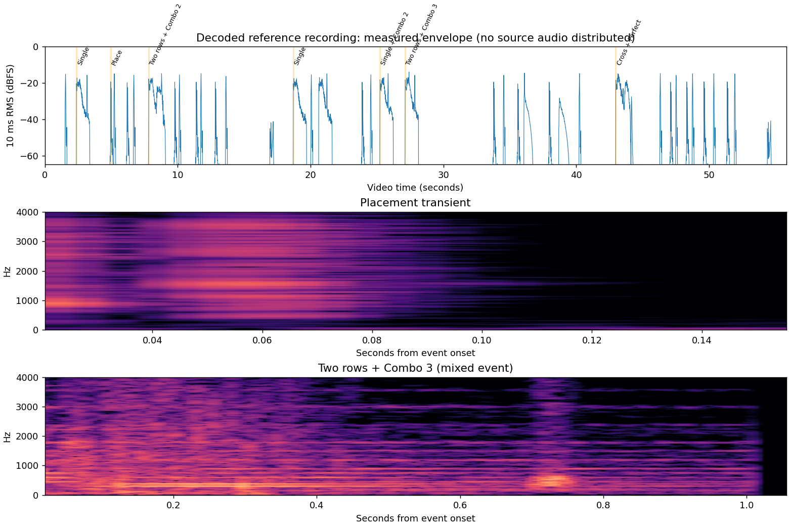
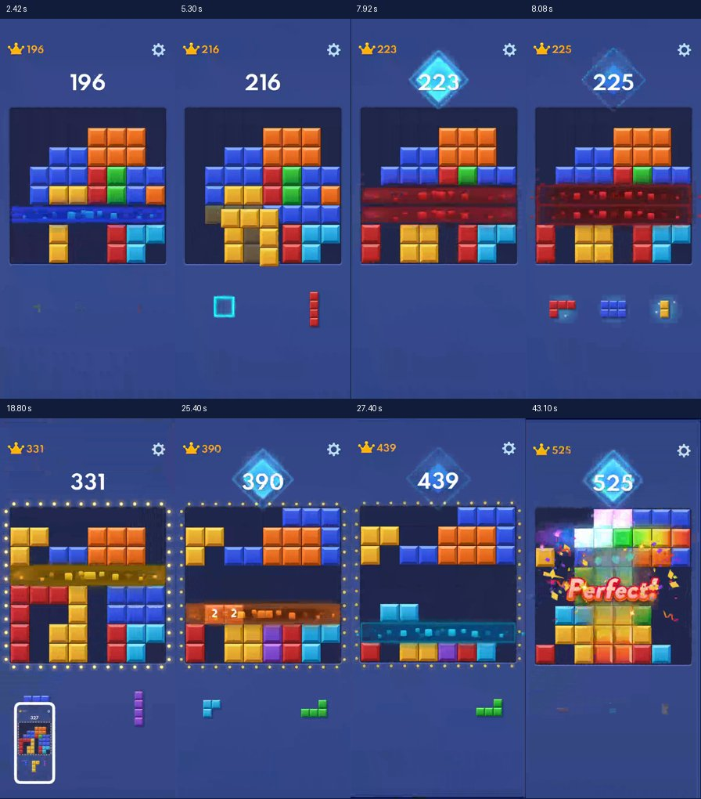

# Block Blast 音效研究与独立试听 · 2026-10-24

本轮仅新增独立试听页，不接入正式游戏。候选全部通过 Web Audio API 原创合成，没有截取、变速、重采样或再发布原版音频，也没有引入第三方音频或语音素材。

试听地址：https://zslhentai.github.io/block-blast-web/audio-lab/index.html

## 素材与分析能力

用户提供的 `2B191A1F-7196-441E-8937-67607C67C6C0.MOV`，SHA-256 为 `54091cd78a5288785db7726154cac90e9b05424f2544035e43f5627503e49422`。视频 HEVC，1180×2556，约 59.5 fps，55.783 秒；音轨 AAC-LC、44,100 Hz、双声道、55.770 秒。云环境已用 FFmpeg 成功解码 PCM，存在非零音频，不是只根据视频画面想象声音。

**能力边界：本次依据实际解码后的波形、频谱和抽帧画面对齐分析，没有人工听审或真实手机扬声器测听。** “轻敲、明亮、气流、共鸣”等词是对频谱和包络的解释及候选音色目标，不应视为已经主观听辨原版音色。是否悦耳、像不像原版，留给用户在 iPhone 上试听判断。也不推断原版采用什么合成器、采样库或引擎。

音频在临时目录处理，不提交源 MOV、PCM 或原版音效片段。随报告提供小尺寸研究帧和测量图，便于定位用户自己的录屏。

## 方法与不确定性

- 用 FFprobe 读取流参数，FFmpeg 将双声道解码成 16-bit PCM；两声道均值用于频谱和包络测量。
- 以 10 ms 窗的 RMS > 0.002（约 −54 dBFS）为活动阈值，相邻活动窗间隔不超过 80 ms 时归并。频谱使用加窗 FFT，比较起音、80 ms、200 ms、400 ms 及尾音。
- 表中的时间是**录屏内音频活动时间**，不是游戏代码里的触发时刻。阈值、AAC 编码、视频帧间隔、录屏音画同步和淡出都会影响边界；音频边界精度约 10–30 ms，音画关联采用更宽的约 ±50–100 ms 窗口。不声称测得实际触控到扬声器延迟。
- 一段活动窗可能含拿起下一块、计分提示或其他叠音，不能把归并时长当作单个音效文件长度。尤其 2.38 秒和 7.81 秒片段的后半段包含下一次交互。
- dBFS 为录屏数字电平，不等于 iPhone 实际声压，也不能直接变成 Web Audio gain。峰值接近的声音可能因持续时间、频谱不同而听感相差很大。

完整活动区间、电平和方法见 [measurements.json](./measurements.json)。

## 画面与声音事件对应

| 录屏时间（秒） | 可见事件及实际测量 | 归属与置信度 |
| --- | --- | --- |
| 1.53–1.67 | 蓝块离开手牌，分数仍 193；有约 140 ms 复合短音，早段频谱峰约 328/371/420/538/592 Hz | **拿起/开始拖拽**，不是落子。与 5.20、6.67、10.10、11.73 秒相似。高置信 |
| 2.38–3.39 | 蓝色整行消失，分数开始从 193 递增；前段有约 264/328/393 Hz 及其泛音，显著衰减后仍有尾音；区间峰 −8.6 dBFS、RMS −23.9 dBFS | **单行消除主层**，高置信；后约 0.8 秒出现额外瞬态，不能全归为消除 |
| 4.95–5.10 | 蓝色长条已落下，计分到 216；约 150 ms 亮音，主要窄带峰约 1502–1577 Hz，另有约 1109 Hz；峰 −9.0 dBFS、RMS −29.2 dBFS | **普通放置后的确认短音**，高置信；仅凭录屏不能区分是在释放还是计分结束时调度 |
| 5.20–5.34 | 黄色块离开手牌、进入棋盘上方，分数仍 216；约 140 ms 低中频短音，峰 −8.9、RMS −23.5 dBFS | 再次确认这是**拿起**反馈；不能当作普通放置素材 |
| 6.19–6.34 | 黄色块落定、分数到 221，约 150 ms 高频短音；峰 −9.3、RMS −29.2 dBFS | 第二次**普通放置后**亮音，支持前一归属 |
| 7.81–9.08 | 红色同时消除两行，随后显示 **Combo 2**；前段频谱峰约 277/350/415 Hz（并有 554/700 Hz）；峰 −8.0、RMS −23.2 dBFS | **双行 + Combo 2 的混合反馈**，高置信。不能由此隔离多行专用音效 |
| 18.70–19.71 | 黄色单行消除；约 261/328/393 Hz 和声，约 1 秒衰减；峰 −9.6、RMS −24.6 dBFS | 比 2.38 秒更干净的**单行消除**参考，高置信 |
| 20.62–21.63 | 紫色单行消除，之后出现 Combo 文字；早段仍约 264/328/393 Hz；峰 −8.7、RMS −23.9 dBFS | 说明显示 Combo 字样并不必然意味着升调；不反推原版完整连击规则 |
| 25.22–26.23 | 橙色**单行**消除，随后 **Combo 2**；约 277/350/415 Hz，峰 −8.8、RMS −23.4 dBFS | 与 7.81 秒双行 + Combo 2 主音组相似，支持**升调与连击相关**而非只由行数决定；仍是推断 |
| 27.12–28.13 | 青色同时消除两行，随后 **Combo 3**；约 293/369/441 Hz，峰 −6.7、RMS −22.9 dBFS | 对应比 Combo 2 约再升半音；有更强的低频/瞬态，无法完全拆层 |
| 42.97–44.23 | 紫色横竖交叉消除，屏幕显示 **Perfect!**；较宽频谱与后段额外瞬态；峰 −5.7、RMS −22.2 dBFS | **交叉消除 + Perfect 奖励混合声**。不作为纯多行或纯 Combo 的可靠样本，本轮也不合成 Perfect 人声 |
| 16.94–17.21、54.38–54.65 | 画面出现系统截图缩略图，低电平宽带瞬态，峰约 −28 dBFS | 可能为系统截图声，排除游戏音效分类 |

图中 5.30 秒是拿起下一块的状态，用于避免误认；普通放置确认短音的测量参考是前一个 4.95 秒区间。Combo 文字一般晚于消除起音出现，表内对连续画面观察后标注事件，不能只用单张图判断连击。

## 声音层次：观察与设计推测

**实际测量支持：**

1. 拿起与放下有明显不同的频谱。拿起低中频短瞬态更饱满，放置后的短音更高、更窄带、整体 RMS 更低。本轮优先制作放置，不额外引入拿起反馈。
2. 单行的约 261/330/392 Hz 主音组接近 C 大三和弦；Combo 2 接近 D♭ 大三和弦，Combo 3 接近 D 大三和弦。由于 FFT 分辨率、编码与音色，表中用近似频率，不声称精确调音标准。
3. 消除前 0.2–0.3 秒能量较集中，0.4 秒后衰减明显，延伸到约 1 秒。谐波与宽带瞬态同时存在，纯正弦“一声滴”不足以表达原版层次。
4. 普通放置短音峰约 −9 dBFS，清除/连击混合窗峰约 −10 至 −6 dBFS；Combo 强化既可能来自更多层也可能来自叠加瞬态，不建议简单逐级加大音量。

**仍是推测或原创设计：**

- “轻敲 + 亮音”“短气流 + 和弦共鸣”“上行短亮音”是从测量结构提出的合成方法，非原版源音轨分离结论。
- 本片没有清楚隔离的“无 Combo 多行消除”样本，无法确定其是否另有采样、具体音高/时长。多行候选采用错开的和声起音与稍长尾音，属于合理待听审方案。
- 录屏没有足够证据还原 Combo 4；试听中的 Combo 4 明确标注“外推候选”，只用于比较音高舒适度。
- 不确认是否包含语音层、混响算法或左右声像设计；本轮不制作人声或外部混响素材。

## 与现有模块对比及原创候选

正式游戏的 `src/audio/sounds.ts` 使用固定正弦：放置 320 Hz / 60 ms，消除 640 Hz / 140 ms，peak gain 0.025，最多 3 个声部。单行、多行、Combo 当前共用消除声，没有分层。这个模块及正式游戏调用保持不变，试听页直接实例化现有 `SoundManager` 播放当前版对照。

新增 `src/audio/audition-cues.ts` 集中配置原创音符、包络和层次；`audition-player.ts` 沿用现有模块的按手势开启 AudioContext、短包络、受限声部、静音/后台停止方式，负责独立试听的生命周期。将来确认后可复用同一合成调度器接入，但本轮没有接入点或存档变更。

| 候选 | 原创结构与参数 | 与参考的关系 |
| --- | --- | --- |
| 普通放置 | 1530→1430 Hz 正弦亮音 140 ms，1110 Hz 轻三角泛音、510→400 Hz 的极轻主体，以及 22 ms 低通生成噪声；2–6 ms 起音 | 靠近放置后的高频短音；音高滑动和层次为原创，不复用原声 |
| 单行消除 | C4/E4/G4 正弦主体 + 弱八度泛音；6 ms 左右起音、三个主声部错开 6 ms，低音 131 Hz、短气流和 1047 Hz 弱尾音；总长 732 ms | 保留和声与快起慢收节奏，初始尾音较录屏稍短，便于快速操作 |
| 多行消除 | 同调性，三主音每隔 32 ms 展开，加一次轻气流和较亮尾声；总长 884 ms | 加强层次而非暴力放大；具体展开方式属于待确认设计 |
| Combo | 复用消除层，Combo 2/3 分别升 1/2 个半音，再加三个从第 140 ms 开始的上行短亮音；总长 850 ms；Combo 4 升 3 半音 | 主调上移受到频谱支持；额外亮音旋律为原创待确认方案 |

所有生成噪声使用固定本地种子，重复试听可比，不读取或消耗游戏 RNG。每声部使用毫秒级起音、指数衰减、末尾 4 ms 收到零，避免突切尾部。四类候选均为单声道居中。最大音量 70% 时，所有声部理论峰值相加仍低于 0.45，未使用响度最大化；默认候选音量 35%。此上限不代表听觉舒适度保证，真机仍需调节媒体音量。

当前版对照保留原模块原音量，不受候选滑杆影响；它与候选没有进行响度匹配。请先调候选音量再评价音色，避免仅因更响就觉得更好。当前版后三个按钮故意播放同一消除提示音，页面有说明。

## 试听页与 iPhone 使用

打开 [独立试听页](https://zslhentai.github.io/block-blast-web/audio-lab/index.html)，点击四种反馈分别试听；可以切换 Combo 2/3/4、调整候选音量、播放连续四种（每种间隔 1.5 秒），随时停止。新点击会停止上一段，避免叠音误导。每个按钮都可以反复点击。

AudioContext 只在点击时创建并请求 resume，兼容 Safari 的用户手势要求；无自动播放、无外部音频请求、无麦克风权限。切后台、页面离开时停止所有已排队声音；返回不自动续播。音量滑杆不写 localStorage，试听页不读取游戏存档。若无声，请检查媒体音量、静音状态和音频输出设备，再次点击。

本页适配安全区域、44–48 px 以上控件及窄屏滚动；没有 iframe 或第三方依赖。正式游戏地址和现有游戏画面均保持原样。

## 验证范围

验证结果见 [validation.md](./validation.md)。浏览器测试是 Linux Chromium 下桌面、iPhone 14 和 Pixel 7 尺寸模拟，**不是实际 iPhone Safari / 安卓扬声器验证**。OfflineAudioContext 测试能确认实际生成波形、采样率、无非有限值、无数字削波和尾部归零，不能替代人的听感验收。

需要用户确认：普通落子亮音是否太尖；单行尾声是否太长；多行是否足够有区别；Combo 2/3 是否有奖励感、是否打扰；日常用手机扬声器和耳机时，音量是否舒服。确认后再单独接入正式游戏，不先行替换。
