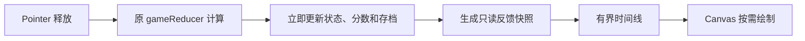
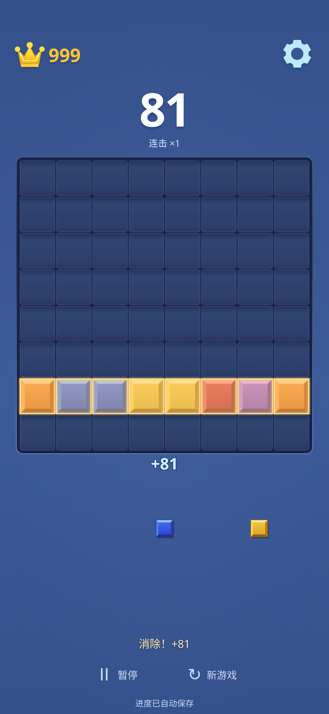
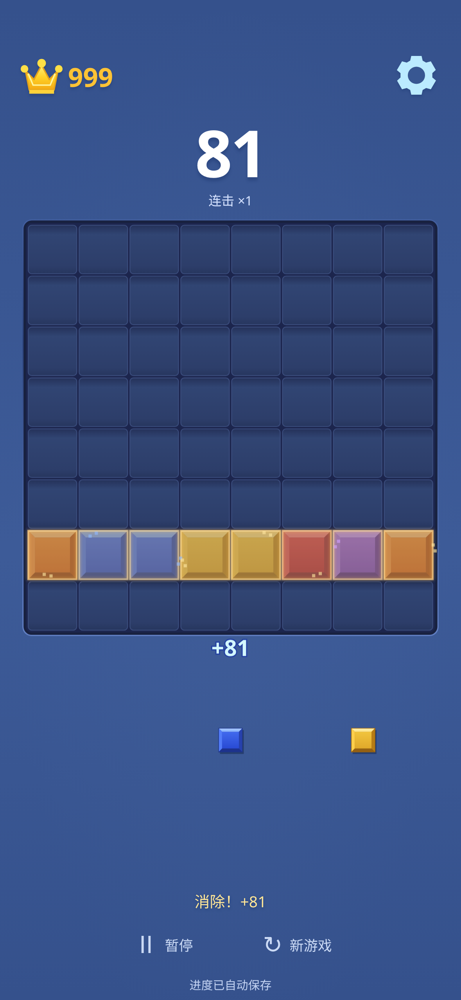
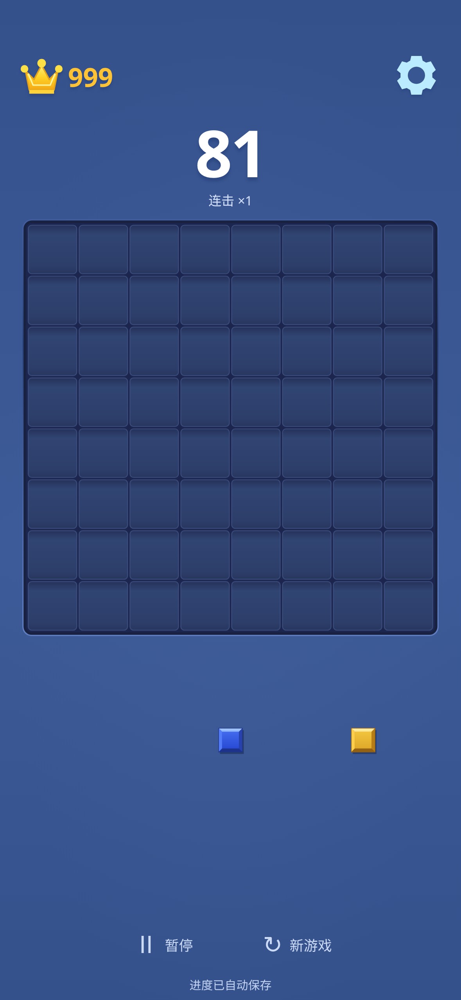

# V2 交互反馈与动画验收

基线：`d5690d6a2f6f3d46e1367e44dca18ca3d9f8b9e0`。开始前同步远端 `work`，确认工作区干净、历史无分歧；重新阅读输入、计分、存档、音效、渲染及六张参考图。

## 实现清单

| 反馈 | 实现与触发条件 |
| --- | --- |
| 拖拽 | 保留 CSS 坐标、DPR 与原手指抬升投影。支持时读取最新 coalesced pointer 样本，按需在下一帧画出当前位置，不增加插值滞后或远距离吸附。松手仍用释放事件的新坐标，由 reducer 再复核 |
| 合法落点 | 浅青轮廓和落点底色；可消除的行列并集增加暖色预览。轮廓在浮动块之后再绘制，完全对齐时也可见 |
| 非法位置 | 红色虚线、低透明度拖影和 × 标记；非法释放给出短槽位轮廓及文字。取消手势只撤销预览，不产生放置/扣牌/加分 |
| 放置 | 只有真实接受的落子触发轻微放大并回落。状态、得分和存档已提交，下一手可立即开始 |
| 行列消除 | 读取落子前完整棋盘的颜色快照，按满行/列并集高亮、短暂发光并淡出，伴随少量方点粒子。交叉格只记录一次 |
| Combo | 仅在真实消除且提交后的 combo≥2 时触发。×2 为浅青，×3–4 为浅紫，×5 及以上为金色，缩放与发光程度递增。首轮普通/多线消除不会冒充连击 |
| 加分 | 真实分数立即更新；棋盘与手牌之间显示短时 `+n` 或 `Combo ×k +n`。原有状态文字反馈保留，减少动画时也能感知结果 |
| 音效 | 复用 Web Audio 合成正弦短音，较低音量与柔和包络，最多 3 个重叠声部；默认关闭，可在原设置中关闭，关闭/暂停会停止当前声部 |

Combo 和加分只占用 V1.1 已有的棋盘/手牌间隙，按间隙高度限制字号并裁剪；开始下一次拖拽时暂时不画标签，防止干扰落点。最新加分提示替换旧标签，快速操作时不会叠满屏幕。粒子限制在棋盘附近，不拦截输入。

没有引入新引擎、外部素材、生产依赖或联网服务。仓库没有已有震动模块，本轮选择复用声音，不新增震动开关、存档字段或对 iPhone 震动支持的承诺。

## 状态与动画解耦

`src/logic/`、`src/storage/`、存档版本和规则保持基线内容。反馈层复用原 placement/lineClear 函数生成视觉快照，不重新定义消除或计分，不消耗玩法 RNG，也不通过动画计时器提交动作。

没有动画输入锁。松手先撤销当前拖拽与 pointer capture，重复 pointerup 不再提交；后续放置继续经过原 shapeId/revision 校验。旧消除快照遇到已被新块占用的格子会跳过，该格以真实新状态为准。终局立即进入原结算流程，并清除反馈，不等待动画完成。

最多保留最近 3 次落子反馈，每次最多 24 粒子，全局最多 48 粒子；没有反馈时停止请求 rAF。粒子为确定性装饰，不用游戏 RNG。暂停、新局、resize、后台隐藏、页面切换和销毁会丢弃瞬态反馈；隐藏时取消待执行帧，回来不补播旧效果。系统 reduce 偏好与设置的“减少动画”取或，系统偏好可实时改变；简化模式不创建放置、清除、粒子或 Combo 动画，保留必要的拖拽指示、即时分数和文字。

## 集中调参

参数在 [`src/renderer/motion.ts`](../../src/renderer/motion.ts)，声音包络在 [`src/audio/sounds.ts`](../../src/audio/sounds.ts)。原版静态图不能确定动画时长，以下为可调初值，不声称测得原版参数。

| 参数 | 初值 |
| --- | --- |
| 手指遮挡补偿 | 保留原 1.15 格额外抬升 |
| 放置轻弹 | 160ms，最大放大约 7.5% |
| 消除高亮保持 / 淡出结束 | 90ms / 360ms |
| 粒子结束 | 460ms |
| Combo 缩放进入 / 整体结束 | 180ms / 760ms |
| 普通加分标签 / 非法槽位反馈 | 560ms / 180ms |
| 文字反馈 | 1100ms，新反馈替换旧反馈 |
| 放置/消除短音 | 60ms / 140ms，峰值增益 0.025 |

## 关键帧证据

关键帧均为 Chromium `iphone-chromium` 预设，CSS 393×852、DPR 3，PNG 1179×2556。测试使用 Playwright 虚拟时钟，名称中的毫秒为名义经过时间，绘制位于最近一次 rAF；这些图不是手机实录、实际帧率或原版时长测量。PNG 直接复制浏览器测试输出，未裁剪、重编码或修改像素。浏览器版本、哈希、参数及 12 条“动画开始时已经提交”记录见 [validation.json](validation.json)。

| 场景 | 关键帧 |
| --- | --- |
| 拖拽预览 | [合法轮廓](keyframes/preview-valid.png) · [非法标记](keyframes/preview-invalid.png) |
| 放置并立即继续 | [32ms：原行尚在淡出，新蓝块已经真实落入该格](keyframes/rapid-replacement-032ms.png) |
| 单行消除 | [约45ms高亮](keyframes/single-row-045ms.png) · [约210ms粒子](keyframes/single-row-210ms.png) · [结束](keyframes/single-row-settled.png) |
| 同时双行 / 双列 | [双行](keyframes/two-rows-210ms.png) · [双列](keyframes/two-columns-210ms.png) |
| 行列交叉 | [高亮](keyframes/cross-045ms.png) · [粒子](keyframes/cross-210ms.png) · [结束](keyframes/cross-settled.png) |
| 分级 Combo | [×2](keyframes/combo-tier-1-080ms.png) · [×3](keyframes/combo-tier-2-080ms.png) · [×5](keyframes/combo-tier-3-080ms.png) |
| Combo 后续阶段 | [约240ms](keyframes/combo-tier-3-240ms.png) · [约600ms](keyframes/combo-tier-3-600ms.png) |

单行过程示例：

| 高亮 | 消散 | 结束 |
| --- | --- | --- |
|  |  |  |

## 检查结果

| 命令 | 结果 |
| --- | --- |
| `bun run typecheck` | 通过 |
| `bun run test` | 74 项通过，0 失败 |
| `bun run test:e2e` | 81 项通过，0 失败；三个 Chromium 配置各 27 项 |
| `bun run build` | 通过 |
| `bun run test:e2e:guard` | 通过，屏蔽生产脚本时正向启动断言按预期失败 |
| `bun run build:portable` / `bun run test:portable` | 通过，断网落子 6 次，联网刷新完整恢复，无外部请求和运行错误 |

单测覆盖行列快照、交叉格去重、原色、普通/连击触发条件、重复动作、资源上限、过期/reset、静音和声部清理。E2E 验证单行、双行、双列、交叉，三档连击与普通落子区别，快速原位重放、重复松手、触控取消、非法释放、暂停、resize、隐藏事件、真实页面离开/返回、系统减少动态效果实时改变；原有规则、终局、存档与移动布局回归全部通过。隐藏状态通过测试中派发 visibilitychange 模拟，不等同真机系统切后台。

320×568、393×852、412×915 三组空盘截图均与 V1.1 的已提交截图逐像素相同。`src/style.css`、`renderer/canvas.ts`、`renderer/draw.ts`、`renderer/theme.ts` 未改；设置仅增加系统减少动态效果的说明。V1.1 的布局、方块材质、安全区和 DPR 支持继续沿用。

## 已知边界与发布

本轮没有发现阻断玩法的问题。测试与图片来自 Linux Chromium，不是 iPhone Safari、安卓 Chrome 真机或 WebKit 验证；真实地址栏/手势区、低端机长时间功耗、触感、动画节奏与音量仍需真机体验后微调。当前选择轻量方点与局部光晕，没有复制原版纸屑、录音、字体或隐藏计分；不声称原版动画还原。

现有 GitHub Actions 在推送 `work` 后先验证再部署，最终提交和发布状态见交付消息。网页地址：<https://zslhentai.github.io/block-blast-web/>。
