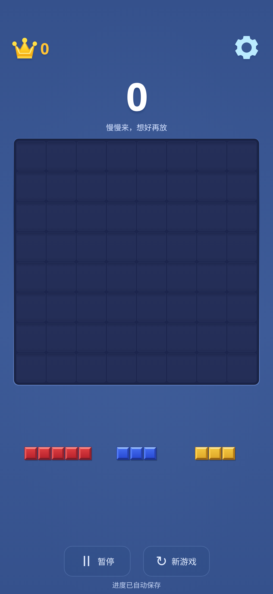
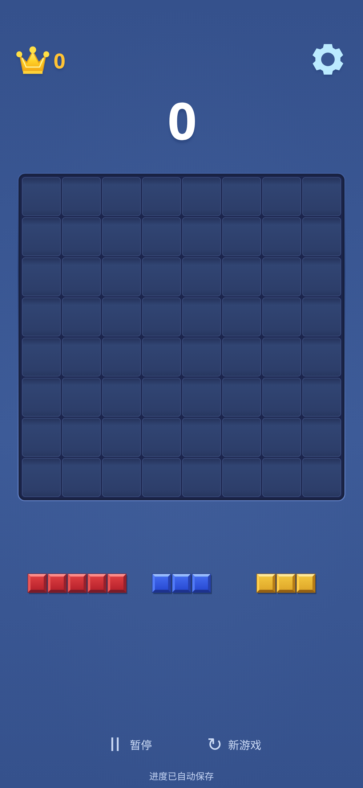

# 视觉 V1.1：比例微调与 V1 对比

基线为 `197498cb38a08c61936d8cda570a2965a9327d9e`。开始前获取远端 `work`，确认本地与远端一致、工作区干净。本轮只修改显示尺寸、绘制颜色、布局和文案，不增加功能、动画、粒子或音效。

## 具体调整

1. 手牌单格的目标比例从棋盘格的 45% 提高至 54%，同时以现有槽宽限制最终尺寸，并为五格长条两侧及阴影保留空间。三个槽的横向范围、点击选择方式和拖拽投影算法保持原样，纵向位置和高度仍统一来自 `calculateLayout`。
2. 共用方块绘制中的顶边高光和右下阴影略增强，棋盘块、手牌块与拖拽块维持同一套倒角、色板和光源方向，没有引入新材质系统。
3. 空格槽提高中心亮度和描边明度，顶部、底部暗边继续保留，格间暗缝及棋盘外框不变。空盘更容易辨认 8×8 边界。
4. 顶部区域略收紧，皇冠上方留白减少；棋盘至托盘的间隔系数从边长的 14% 降至 10%。短屏继续以可用高度约束棋盘，不拉伸形状。
5. 暂停、新游戏使用透明背景和透明边框，文字略柔和；每个点击区域仍至少 96×44 CSS px，键盘焦点和按下反馈保留。横屏短视口也不再压缩到 36px 高。
6. 从 HTML 初始内容和运行时显示中移除“慢慢来，想好再放”。实际连击文字继续显示，但不参与正常布局，出现/消失不会挤动分数或棋盘。

没有修改规则、计分、发牌、存档、暂停/恢复、终局、触控取消或投影算法。`src/index.ts` 只改了无连击时的显示字符串；`src/logic/`、`src/storage/`、`src/audio/`、`src/renderer/input.ts` 和 `src/renderer/index.ts` 均与基线一致。没有新增依赖或修改 GitHub Actions。

## 移动端截图对比

使用 V1 已提交的截图作为“调整前”，V1.1 采用相同视口、Chromium 设备预设、DPR 和确定性空盘/手牌场景。新 PNG 直接复制测试输出，未裁剪或重编码。浏览器版本、DPR、尺寸、哈希和测量记录见 [validation.json](validation.json)。

| CSS 视口 | V1 | V1.1 |
| --- | --- | --- |
| 320×568，DPR 3 | [短屏空盘](../visual-v1/screenshots/empty-320x568.png) | [短屏空盘](screenshots/empty-320x568.png) |
| 393×852，DPR 3 | [基准空盘](../visual-v1/screenshots/empty-393x852.png) | [基准空盘](screenshots/empty-393x852.png) |
| 412×915，DPR 2.625 | [长屏空盘](../visual-v1/screenshots/empty-412x915.png) | [长屏空盘](screenshots/empty-412x915.png) |
| 393×852，混色棋盘 | [混色棋盘](../visual-v1/screenshots/mixed-393x852.png) | [混色棋盘](screenshots/mixed-393x852.png) |
| 393×852，触控拖拽中 | [拖拽中](../visual-v1/screenshots/drag-393x852.png) | [拖拽中](screenshots/drag-393x852.png) |

基准尺寸并排预览：

| V1 | V1.1 |
| --- | --- |
|  |  |

| 视口 | 手牌单格 V1 → V1.1 | 棋盘顶部 y | 手牌中心 y |
| --- | --- | --- | --- |
| 320×568 | 12.79 → 15.80px（+23.5%） | 136 → 126px | 431.1 → 426.9px |
| 393×852 | 19.51 → 21.57px（+10.6%） | 202.1 → 191.3px | 650.2 → 630.7px |
| 412×915 | 20.49 → 22.68px（+10.7%） | 216.2 → 206.9px | 686.7 → 668.4px |

已逐张检查新截图。手牌更醒目，格槽边界更清晰，基准/长屏的棋盘和托盘更靠近上部主体；底部按钮不再呈现两个卡片边框。短屏棋盘边长从 227.33 增至 234px，其他两种尺寸棋盘边长不变。棋盘与方块均保持正方形比例，没有遮挡或页面横向/纵向溢出。

以上均为 Linux Chromium 模拟：`iphone-chromium` 的 DPR 为 3，`android-chromium` 的 DPR 为 2.625。本轮没有新的 iPhone Safari 或安卓 Chrome 真机测试，用户对 V1 的真实 iPhone 反馈不能当作 V1.1 已通过真机验证。

## 测试与发布

| 检查 | 本地结果 |
| --- | --- |
| `bun run typecheck` | 通过 |
| `bun run test` | 61 项通过，0 失败 |
| `bun run test:e2e` | 48 项通过，0 失败，三个 Chromium 配置各 16 项 |
| `bun run build` | 通过 |
| `bun run test:e2e:guard` | 通过，生产脚本被屏蔽时启动断言按预期失败 |
| `bun run build:portable` / `bun run test:portable` | 通过，载入后断网落子 6 次，联网刷新恢复完整状态 |

沿用并运行所有目录形状在四组布局中的槽位及阴影边界单测。E2E 在三种手机尺寸检查无遮挡、无溢出、高 DPI、按钮点击区域，并通过实际触控落下三格及五格横条；额外检查五格竖条及连击结束前后布局不移动。触控结果由棋盘数组、得分和目标格绘制像素共同验证。原有暂停、取消、resize、消除、终局及刷新存档测试全部通过。

推送 `work` 后沿用现有验证与 Pages 部署流程，最终 Actions 状态在交付消息报告。网页地址：<https://zslhentai.github.io/block-blast-web/>。
